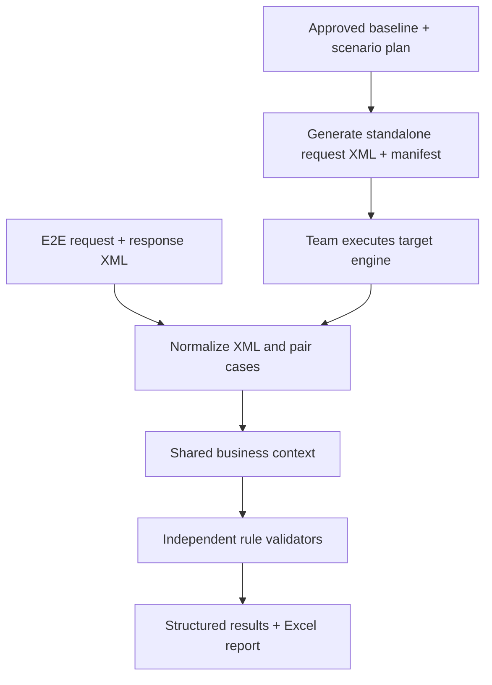

# Credit Decision UAT Validation — Design Blueprint

> Public, generic design reference. **Not** a production implementation, policy source, or repository for confidential workbench material.

## Purpose

Provide requirements and implementation guidance for an existing credit-decision UAT validation workbench. The workbench already exists, but its architecture and quality have **not** been inspected from this repository.

**Copilot must audit the existing workbench and independently recommend one of: (a) keep and improve, (b) targeted refactor, or (c) rebuild**, based on observed correctness, testability, maintainability, security, and migration cost. Do not assume either rewrite or preservation is the answer. Compare alternatives and explain evidence before making changes.

## Confirmed workflows

| Workflow | Request | Response | Purpose |
|---|---|---|---|
| E2E | Real target-engine UAT request XML | Corresponding UAT response XML | Validate behavior at engine boundary; identify integration problems when upstream evidence exists |
| Standalone | Tester-controlled target-engine scenario XML | Response XML produced by a separate execution team | Deterministic boundary, missing, invalid, precedence and interaction testing |

- Request XML elements are optional and vary by case. Target responses are relatively standardized.
- Legacy-engine logs use JSON, with differing schemas and some intentionally changed business logic. Historical JSON conversion and legacy/target parity are **deferred**.
- Standalone testing can set any input variables. Requests are passed to the target engine for execution; expected results must be independently determined from approved rules.
- Use modular validators (assessment type, documents, scorecard/SMV, caps/limits) and shared business functions (e.g. subpopulation).
- Prefer **Excel** with Summary, Validation Details, Scenario List and Rule Coverage; preserve structured machine-readable results. Jupyter is optional for investigation.

## Recommended logical data flow (not a mandated implementation)

Expected calculations must not copy actual target responses. Upstream mapping cannot be declared correct from engine-boundary request/response logs alone.

## Copilot reading order

1. [COPILOT_HANDOFF.md](COPILOT_HANDOFF.md) — initial read-only inspection task.
2. [docs/05-existing-workbench-audit.md](docs/05-existing-workbench-audit.md) — audit and **evidence-based rebuild versus refactor decision**.
3. [.github/copilot-instructions.md](.github/copilot-instructions.md) — operational safeguards.
4. [docs/01-requirements.md](docs/01-requirements.md), [docs/02-architecture.md](docs/02-architecture.md), [docs/03-scenario-generation.md](docs/03-scenario-generation.md), [docs/04-reporting-and-quality.md](docs/04-reporting-and-quality.md), [docs/06-roadmap.md](docs/06-roadmap.md), [docs/07-decisions.md](docs/07-decisions.md) — detail, phased acceptance, and decision history.
5. [SECURITY.md](SECURITY.md) — public/private boundary.

## First usable milestone (adjust after audit)

Given fictional/approved XML and documented rules: generate a small reviewed batch of boundary/missing/invalid cases, reconcile team-returned responses, validate a shared subpopulation rule and assessment type, output an Excel report, and prove at least one known-good and one deliberately altered known-bad result.

These are **functional acceptance criteria**, not instructions to rebuild the existing workbench.

## Public repository safety

Only generic design documents and fictional examples are allowed here. Never upload source code from the institution, customer data, real request/response logs, proprietary decision tables, thresholds, scorecard parameters, credentials, or restricted defect reports. Follow internal approvals even if this repo is publicly readable.
