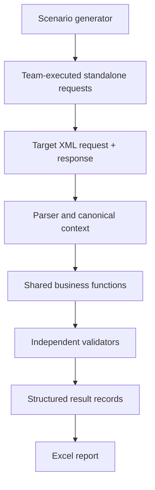

# Logical architecture — adaptable reference

**This is a conceptual separation of responsibilities, NOT a mandated Python folder structure.** Copilot should decide which components are needed after auditing existing code.

## Responsibilities

1. **Input adapter:** securely parse target XML requests/responses; preserve field states, namespaces, provenance, XPath and source files.
2. **Canonical business context:** expose stable semantic variables to validators, not XML-specific XPath in every module; avoid collapsing fields that have different meanings.
3. **Shared calculations:** classify subpopulation and other reused business values once, with rule ID, inputs, policy version and evaluation trace.
4. **Independent validators:** determine applicability, calculate expected, extract actual, compare, explain.
5. **Standalone scenario generator:** reviewable plan → copy/mutate a validated XML baseline → case manifest. Independent of expected-result calculation.
6. **Reporter:** Excel for reviewers plus JSON/CSV evidence. Do not embed entire raw XML in cells.



## XML field semantics

| State | Example | Meaning |
|---|---|---|
| ABSENT | no element | not provided; not equivalent to empty |
| EMPTY | `<Field></Field>` | present with empty text |
| NIL | `<Field xsi:nil="true"/>` | explicitly null where supported |
| VALUE_ZERO | `<Field>0</Field>` | actual numeric zero |
| INVALID | `<Field>ABC</Field>` for numeric field | negative-test or parsing error |
| VALUE | `<Field>30000</Field>` | valid parsed value |

Use secure XML parsing with network/external DTD and entity expansion disabled. Distinguish intentionally invalid test requests from mistakes in generating positive scenarios.

## Thin validator contract — conceptual

- `can_validate(context)`: is rule applicable and are prerequisites present?
- `calculate_expected(context, approved_rules)`: independent expected value + trace.
- `extract_actual(response)`: returned value, if any.
- `compare(expected, actual, comparison_rules)`: PASS, FAIL or explicit uncertainty.
- Structured explanation: case ID, rule ID, inputs, classification dependencies, reason, rule/engine version, XML evidence paths.

Choose functions or classes consistent with working code. Only abstract when there is real reuse. Avoid actual target response in expected calculations; response-only invariants may be checked separately.

## Shared subpopulation

Resolve from request-side inputs under versioned approved criteria. Support unknown or overlapping classifications and precedence if required. Downstream validators must not turn upstream unknowns into PASS. If the response reports a classification, compare it as a separately testable actual.

## Result example — fictional

```json
{"case_id":"DEMO-001","module":"assessment_type","rule_id":"DEMO-R01","expected":"TYPE_B","actual":"TYPE_A","status":"FAIL","reason":"independently computed mismatch","policy_version":"demo-only"}
```

Never presume the example matches any internal schema or actual policy.
